  

  <em>"Learning offense to build better defense."</em>

## // About

I'm an ethical hacker and pentester with a Bachelor in Information Systems. I enjoy finding weaknesses in web applications, mobile apps and infrastructure before someone else does.

## // Technologies

  &nbsp;&nbsp;&nbsp;
  &nbsp;&nbsp;&nbsp;
  &nbsp;&nbsp;&nbsp;
  &nbsp;&nbsp;&nbsp;
  &nbsp;&nbsp;&nbsp;
  &nbsp;&nbsp;&nbsp;
  &nbsp;&nbsp;&nbsp;
  &nbsp;&nbsp;&nbsp;
  

## // Certifications

- eJPT
- eCPPT
- Security+

## // Contributions

  <picture>
    <source media="(prefers-color-scheme: dark)" srcset="https://raw.githubusercontent.com/kaskamilla/kaskamilla/output/snake-dark.svg" />
    <source media="(prefers-color-scheme: light)" srcset="https://raw.githubusercontent.com/kaskamilla/kaskamilla/output/snake.svg" />
    
  </picture>

## // Contact

[LinkedIn](https://www.linkedin.com/in/willyahir-vargas)
